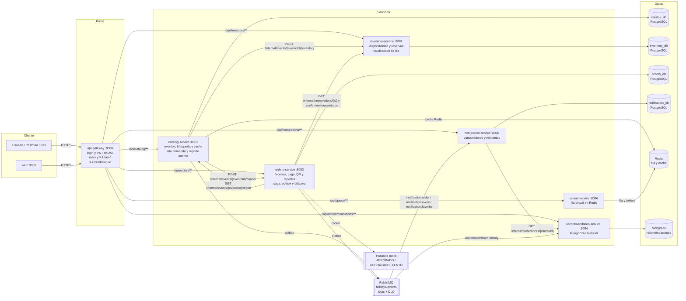
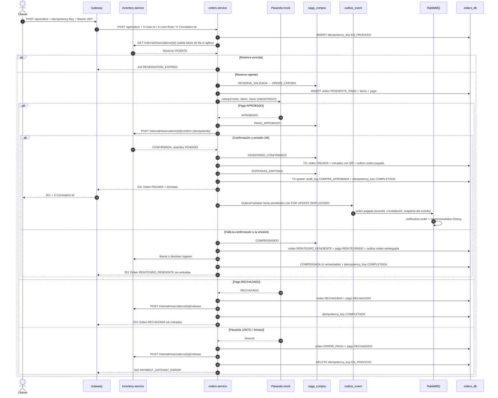
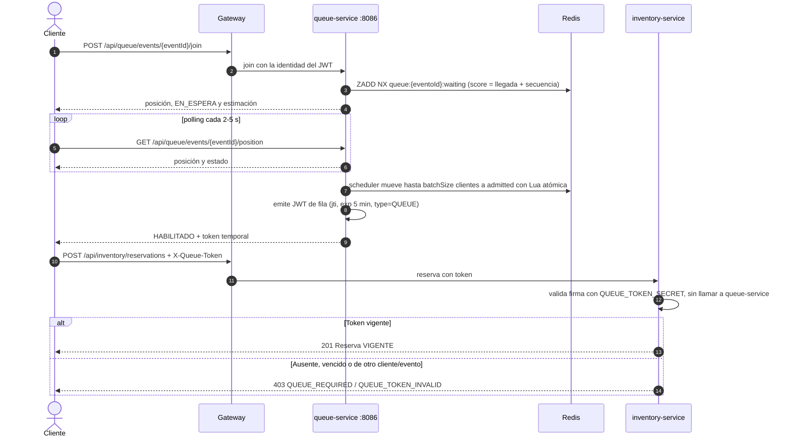
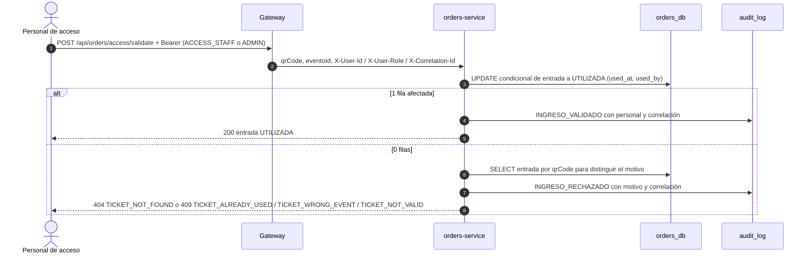
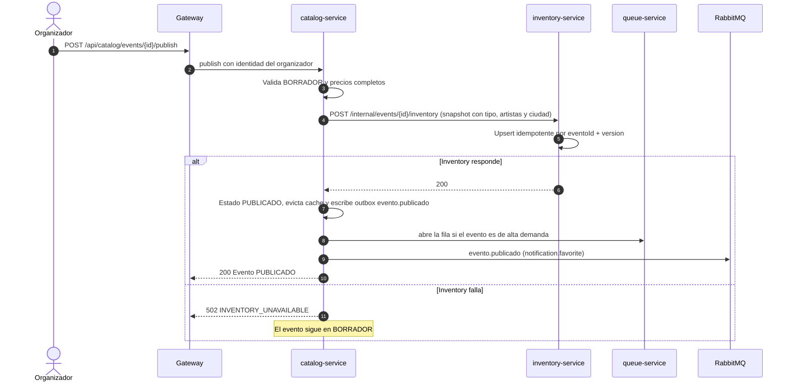
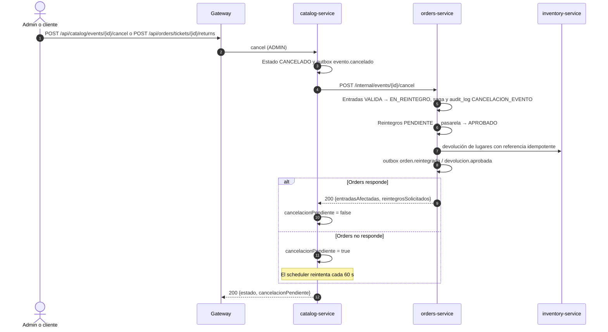
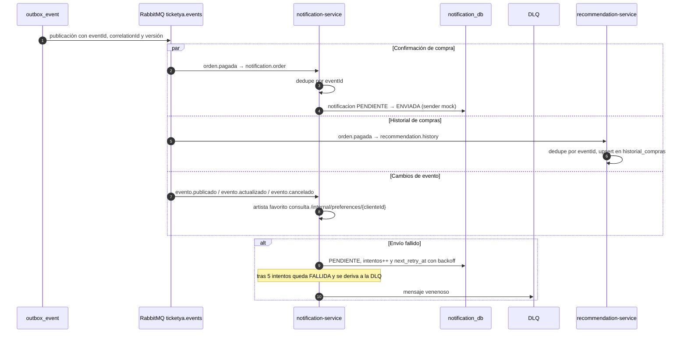
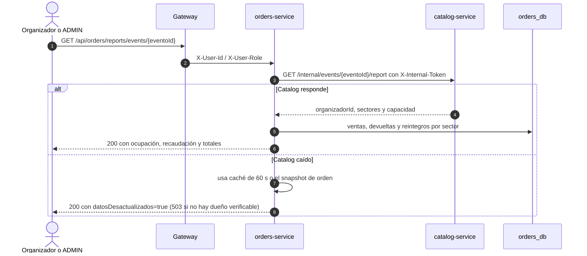

# Arquitectura — TicketYa Entrega 2

Este documento resume los límites de servicio, las dependencias, la estrategia de consistencia y los flujos críticos de la Entrega 2: compra con saga/outbox, fila virtual, acceso con QR, notificaciones y reportes.
El detalle técnico completo está en [`../openspec/changes/entrega-2-completo/design.md`](../openspec/changes/entrega-2-completo/design.md) (y en [`../openspec/changes/entrega-1-core/design.md`](../openspec/changes/entrega-1-core/design.md) el origen de la Entrega 1), el contrato en [`api-contract.md`](api-contract.md), el modelo de cada base en [`modelo-datos.md`](modelo-datos.md), las decisiones con sus alternativas en [`decisiones.md`](decisiones.md) y el contrato de eventos en [`eventos.md`](eventos.md).

## 1. Diagrama de módulos

- El cliente nunca llama a los servicios por dentro: todo entra por el gateway, que valida el JWT, aplica la matriz por rol, descarta los `X-User-*` del cliente y propaga la identidad y `X-Correlation-Id`.
- Cada servicio es dueño de su base o colección y no comparte tablas. Los cruces son REST por `/internal/**` (con `X-Internal-Token`) o eventos de dominio por RabbitMQ.
- `inventory-service` valida el token de la fila localmente con `QUEUE_TOKEN_SECRET`, sin llamar a `queue-service` en el camino crítico de la reserva.
- Los productores escriben el evento en un `outbox_event` dentro de la transacción de negocio; un publicador separado lo entrega a RabbitMQ con al menos una vez.
- El compose levanta los siete servicios, cuatro PostgreSQL, MongoDB, Redis y RabbitMQ. Solo el gateway (8080) y la web (3000) publican puertos. Los usuarios de prueba del login viven en `DemoUserStore` (BCrypt en memoria): `auth_db`, previsto en el `design.md`, queda como evolución no implementada en esta entrega.

### Límites de servicio y dueño del dato

| Servicio | Responsabilidad | Datos propios | No hace |
|---|---|---|---|
| `api-gateway` | Punto de entrada, login, JWT HS256, autorización por rol, correlación y ruteo | Usuarios de prueba en memoria con BCrypt | No contiene reglas de negocio |
| `catalog-service` | Lugares, eventos, precios, publicación, búsqueda paginada, cache, alta demanda y datos de reporte | `catalog_db` + claves `catalog:*` en Redis | No escribe disponibilidad ni emite entradas |
| `inventory-service` | Disponibilidad, reservas, no doble venta, límite por cliente y validación del token de fila | `inventory_db` | No conoce el catálogo completo ni los pagos |
| `orders-service` | Órdenes, pago mock, entradas/QR, acceso, reportes, devoluciones, saga, outbox y bitácora | `orders_db` | No modifica catálogo ni disponibilidad por su cuenta |
| `queue-service` | Fila virtual, posiciones, tandas y tokens temporales de compra | Redis (`queue:{eventoId}:*`) | No decide disponibilidad ni reserva lugares |
| `recommendation-service` | Preferencias, historial y recomendaciones | MongoDB `recommendation_db` | No consulta catalog para armar el historial |
| `notification-service` | Consumo de eventos, envío simulado, reintentos y DLQ | `notification_db` | No bloquea la compra ni la cancelación |

Los cruces usan IDs y snapshots: catalog publica hacia inventory, inventory confirma o libera ante orders y orders emite las entradas. Ninguna base tiene claves foráneas contra otra; el detalle está en [`modelo-datos.md`](modelo-datos.md).

## 2. Secuencia de compra con saga y outbox

Cubre los tres resultados de la pasarela, la reserva vencida y los pasos persistidos de la saga (tareas 4.3 a 4.7 y 6.2/6.3). El evento `orden.pagada`, la bitácora `COMPRA_APROBADA` y el cambio de estado comparten la misma `X-Correlation-Id`.

- Cada comando a inventory y a la pasarela usa una clave de idempotencia derivada de `ordenId:paso`; repetir un paso no duplica reserva, cobro, confirmación ni entrada.
- La emisión ocurre en una transacción propia junto con el cambio a `PAGADA` y el `outbox_event`. Nunca existe una orden `PAGADA` sin entradas válidas.
- El `audit_log` se escribe con `REQUIRES_NEW` y captura su propio error: si la bitácora falla, la compra no se revierte.
- El publicador reintenta con backoff sin perder el `eventId`; los consumidores deduplican por `eventId`.

## 3. Fila virtual

Para eventos de alta demanda, `queue-service` ordena el acceso en Redis y `inventory-service` exige un token temporal firmado al reservar. Es polling con tandas, no WebSockets.

- Reingresar conserva la posición (`ZADD NX`); las tandas respetan el orden de llegada y no habilitan a quien está detrás.
- Al cancelar o agotar el evento la fila se cierra; los tokens ya emitidos vencen por TTL. Redis con AOF conserva posiciones ante reinicio; si Redis falla, los eventos de alta demanda hacen *fail closed*.

## 4. Acceso con QR

El dueño del QR es `orders-service`. El uso único se garantiza con un `UPDATE` condicional atómico, igual que la no doble venta, nunca con `find` + `save`.

La condición del `UPDATE` es `estado = 'VALIDA' AND used_at IS NULL` sobre el `qrCode` y el `eventoId`. Dos escaneos concurrentes del mismo QR producen exactamente un `200` y un `409`. Cada intento se registra en `audit_log` con `X-Correlation-Id`; la escritura es best-effort y no revierte el ingreso. No se guarda la imagen del QR.

## 5. Publicación de un evento

## 6. Cancelación de evento y devolución

La devolución aprobada reutiliza `POST /internal/returns` de inventory con una `referencia` para que la reposición de zonas no numeradas sea idempotente. `DevolucionRetryService` y `ReintegroRetryService` reintentan los estados `PROCESANDO` y `PENDIENTE`.

## 7. Notificaciones asíncronas

La compra nunca espera a notification-service. Los eventos salen del outbox y cada consumidor aplica su efecto una sola vez por `eventId`.

- La topología, las routing keys y los payloads están congelados en [`eventos.md`](eventos.md). `notification.order`, `notification.event`, `notification.favorite` y `recommendation.history` tienen su DLQ `*.dlq`.
- `orden.reintegrada` y `devolucion.aprobada` ya se publican desde el outbox, pero sus bindings hacia `notification.order` siguen pendientes de declarar; `entrada.utilizada` no tiene consumidor en esta entrega.
- Si RabbitMQ está caído, el evento permanece en `outbox_event` y el publicador reintenta; la operación de negocio ya se completó.

## 8. Reporte del organizador

El reporte calcula vendidas, devueltas, netas, ocupación (`netas / capacidad`) y recaudación por sector. La capacidad y el organizador viven en catalog; los importes y las entradas viven en orders. Un organizador ajeno recibe `403 NOT_EVENT_OWNER`.

## 9. Decisiones de consistencia

| Situación | Mecanismo |
|---|---|
| Doble venta de asientos | `SELECT ... FOR UPDATE` ordenado por `asientoId` dentro de la transacción |
| Sobreventa de zonas | `UPDATE ... WHERE disponibles >= N RETURNING` |
| Acceso a eventos de alta demanda | Token de fila firmado validado por inventory; *fail closed* si Redis no responde |
| Reintento de compra | `idempotency_key` con claim `EN_PROCESO` y respuesta guardada |
| Pasos de la compra | Saga orquestada en `saga_compra` con claves `ordenId:paso` y compensaciones |
| Evento perdido entre servicios | `outbox_event` en la misma transacción + publicación con al menos una entrega |
| Evento duplicado | `eventId` registrado por cada consumidor (idempotencia) |
| Pago aprobado con fallo posterior | Orden `REINTEGRO_PENDIENTE`, pago `REINTEGRADO` y liberación/devolución |
| Cancelación sin orders | `cancelacion_pendiente` + scheduler de reintento |
| Uso único del QR | `UPDATE` condicional atómico sobre `estado` y `used_at` |
| Notificación lenta o caída | Consumo asíncrono, reintentos con backoff y DLQ; la compra no espera |
| Bitácora caída | `audit_log` con `REQUIRES_NEW` y error capturado: no revierte la operación |
| Reporte con catalog caído | Caché de 60 s o snapshot local y `datosDesactualizados: true` |
| Reserva vencida | Scheduler cada 30 s y validación perezosa al consultar/pagar |

La consistencia es **fuerte dentro de cada servicio** (transacción local + constraints) y **eventual entre servicios**. La disponibilidad se lee de inventory, el QR y las ventas de orders, las preferencias de MongoDB y la capacidad de catalog. Los snapshots congelan nombre, fecha, precio, tipo, artistas y ciudad para que la compra, las notificaciones y las recomendaciones no dependan de una llamada en vivo. Las alternativas y consecuencias están en [`decisiones.md`](decisiones.md) (ADR-005 a ADR-019) y en el [`design.md`](../openspec/changes/entrega-2-completo/design.md) (decisiones 1 a 15).

## 10. Deuda y trabajo pendiente

Resueltas respecto de la Entrega 1: la saga y el outbox formales (6.2/6.3), la búsqueda paginada con cache Redis, el contrato de eventos con snapshot de `orden.pagada` (ADR-017/018) y la identidad por JWT en el gateway.

Sigue pendiente o con simplificación documentada:

- **Observabilidad centralizada:** logs JSON con correlación y MDC ya están en los servicios; Loki, Promtail y Grafana quedan para la tarea 9.4.
- **`auth_db`:** el login usa usuarios de prueba con BCrypt en memoria (`DemoUserStore`); la base de usuarios del `design.md` no está implementada.
- **Bindings de eventos:** `orden.reintegrada` y `devolucion.aprobada` no están enlazados a `notification.order`, y `entrada.utilizada` no tiene consumidor; ver [`eventos.md`](eventos.md).
- **N+1 en el listado de órdenes:** `OrderQueryService` sigue consultando ítems y entradas por orden; no se abordó en esta entrega.
- **Reservas vencidas e idempotencia huérfana:** el scheduler libera cada 30 s y una clave `EN_PROCESO` se limpia al registrar una clave nueva; el comportamiento se conserva de la Entrega 1.
- **Verificación con el stack levantado:** los tests Testcontainers y la suite E2E (8 flujos) requieren Docker; se ejecutan con `docker compose up --build` y `TICKETYA_E2E=true mvn -B -ntp verify` desde `integration-tests`.
