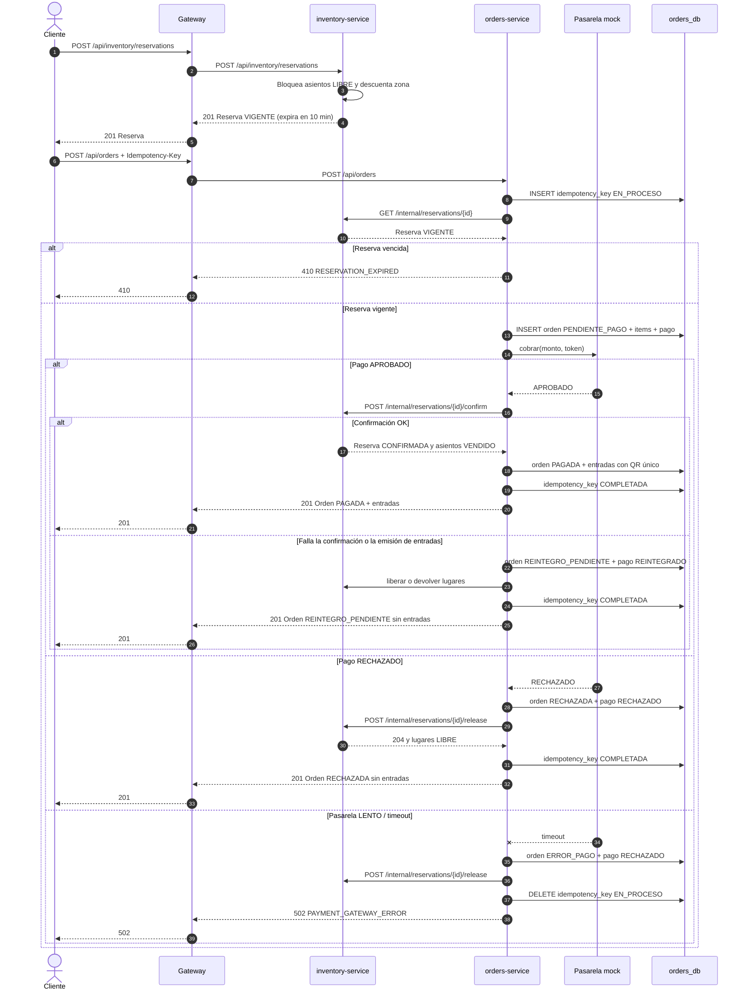
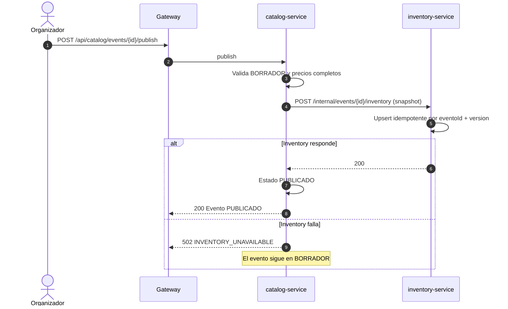
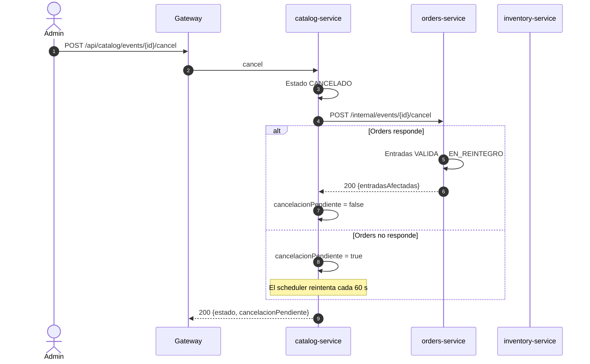

# Arquitectura — TicketYa Entrega 1

Este documento resume los límites de servicio, las dependencias, la estrategia de consistencia y el flujo de compra.
El detalle técnico completo está en [`../openspec/changes/entrega-1-core/design.md`](../openspec/changes/entrega-1-core/design.md),
el contrato en [`api-contract.md`](api-contract.md), el modelo de cada base en [`modelo-datos.md`](modelo-datos.md)
y las decisiones con sus alternativas en [`decisiones.md`](decisiones.md).

## 1. Diagrama de módulos

```mermaid
flowchart LR
    subgraph Cliente
        U[Usuario / Postman / curl]
    end

    G[api-gateway<br/>:8080]

    subgraph Catalog[catalog-service :8081]
        C1[Lugares y sectores]
        C2[Eventos y precios]
        C3[Publicación y estados]
        C4[Búsqueda]
    end

    subgraph Inventory[inventory-service :8082]
        I1[Disponibilidad]
        I2[Reservas y límites]
        I3[Confirmación y liberación]
    end

    subgraph Orders[orders-service :8083]
        O1[Órdenes]
        O2[Pasarela mock]
        O3[Entradas y QR]
        O4[Idempotencia y compensaciones]
    end

    CDB[(catalog_db<br/>PostgreSQL :5433)]
    IDB[(inventory_db<br/>PostgreSQL :5434)]
    ODB[(orders_db<br/>PostgreSQL :5435)]
    PAGO[[Pasarela mock<br/>APROBADO / RECHAZADO / LENTO]]

    U -->|HTTP| G
    G -->|/api/catalog/**| Catalog
    G -->|/api/inventory/**| Inventory
    G -->|/api/orders/**| Orders

    Catalog --> CDB
    Inventory --> IDB
    Orders --> ODB

    Catalog -->|POST /internal/events/{id}/inventory| Inventory
    Catalog -->|POST /internal/events/{id}/cancel| Orders
    Orders -->|GET /internal/reservations/{id}| Inventory
    Orders -->|POST confirm / release / returns| Inventory
    Orders -->|cobrar| PAGO
```

- El cliente nunca llama a los servicios por dentro: todo entra por el gateway.
- Cada servicio es dueño de su base y no comparte tablas.
- Las dependencias internas son REST y usan los endpoints `/internal/**`.

### Límites de servicio y dueño del dato

| Servicio | Responsabilidad | Datos propios | No hace |
|---|---|---|---|
| `catalog-service` | Lugares, sectores, asientos, eventos, precios, publicación, estados y búsqueda | `lugar`, `sector`, `asiento`, `evento`, `evento_participante`, `evento_sector_precio` | No escribe disponibilidad ni emite entradas |
| `inventory-service` | Disponibilidad, reservas temporales, límite por cliente y no doble venta | `evento_inventario`, `sector_inventario`, `asiento_inventario`, `reserva`, `reserva_item`, `cliente_evento` | No conoce el catálogo completo ni los pagos |
| `orders-service` | Órdenes, pago mock, entradas/QR, devoluciones y reintegros | `orden`, `orden_item`, `pago`, `entrada`, `devolucion`, `idempotency_key` | No modifica catálogo ni disponibilidad por su cuenta |
| `api-gateway` | Ruteo, identidad de Entrega 1 y correlación | Sin datos | No contiene reglas de negocio |

Los cruces usan IDs y snapshots: catalog publica hacia inventory, inventory confirma o libera ante orders y orders emite las entradas. Ninguna base tiene claves foráneas contra otra; el detalle está en [`modelo-datos.md`](modelo-datos.md).

## 2. Secuencia de compra de una entrada numerada

Cubre los tres resultados de la pasarela y la reserva vencida (tareas 4.3 a 4.7).



## 3. Publicación de un evento



## 4. Cancelación de evento y devolución



La devolución aprobada (Día 4) reutiliza el endpoint interno
`POST /internal/returns` de inventory con una `referencia` para que la reposición
de zonas no numeradas sea idempotente.

## 5. Decisiones de consistencia

| Situación | Mecanismo |
|---|---|
| Doble venta de asientos | `SELECT ... FOR UPDATE` ordenado por `asientoId` dentro de la transacción |
| Sobreventa de zonas | `UPDATE ... WHERE disponibles >= N RETURNING` |
| Reintento de compra | `idempotency_key` con claim `EN_PROCESO` y respuesta guardada |
| Pago aprobado con fallo posterior | Orden `REINTEGRO_PENDIENTE`, pago `REINTEGRADO` y liberación/devolución |
| Cancelación sin orders | `cancelacion_pendiente` + scheduler de reintento |
| Reserva vencida | Scheduler cada 30 s y validación perezosa al consultar/pagar |

La consistencia entre servicios es **eventual y explícita**: catalog publica un snapshot y solo confirma si inventory lo aceptó; inventory es la fuente de la disponibilidad y el callback de `AGOTADO`/`PUBLICADO` hacia catalog está **pendiente de implementación** (observación del 9/11); orders nunca marca `PAGADA` sin la confirmación de inventory. Los snapshots congelan nombre, fecha y precio para que la compra y la devolución no dependan de una llamada en vivo. Cada llamada interna es idempotente para que un reintento no duplique inventario, entradas ni reintegros. Las alternativas y consecuencias de cada mecanismo están en [`decisiones.md`](decisiones.md) (ADR-005 a ADR-013).

### Deuda conocida (Entrega 1 → Entrega 2)

- **Compra con transacción local y llamadas HTTP:** `OrderService.crear` ejecuta la compra en
  una transacción local mientras llama a inventory y a la pasarela. La saga/outbox formal y
  la separación de transacciones quedan para la Entrega 2. `noRollbackFor = ApiException`
  persiste el camino de pasarela caída; un fallo de base dentro de `TicketService.emitir`
  todavía puede marcar la transacción rollback-only y la compensación no persistirse.
  `OrderTransactionIntegrationTest` cubre el camino de pasarela; el caso de emisión con base
  real queda como limitación documentada.
- **Búsqueda en memoria:** `catalog-service` trae los eventos, ordena y pagina en memoria. Con
  el volumen de la Entrega 1 alcanza; la consulta paginada en base queda para la Entrega 2.
- **N+1 en listado de órdenes:** `OrderQueryService.ordenes` realiza consultas por orden para
  traer ítems y entradas. Con el volumen de la Entrega 1 es aceptable; se puede optimizar con
  batch queries o fetch joins en la Entrega 2.
- **Snapshot con `version = 1L`:** un evento se publica una vez; el `eventoId + version` de
  ADR-005 queda preparado para futuras republicaciones.
- **“Suspender”:** en la Entrega 1 se resuelve como cancelación (ADR-012).
