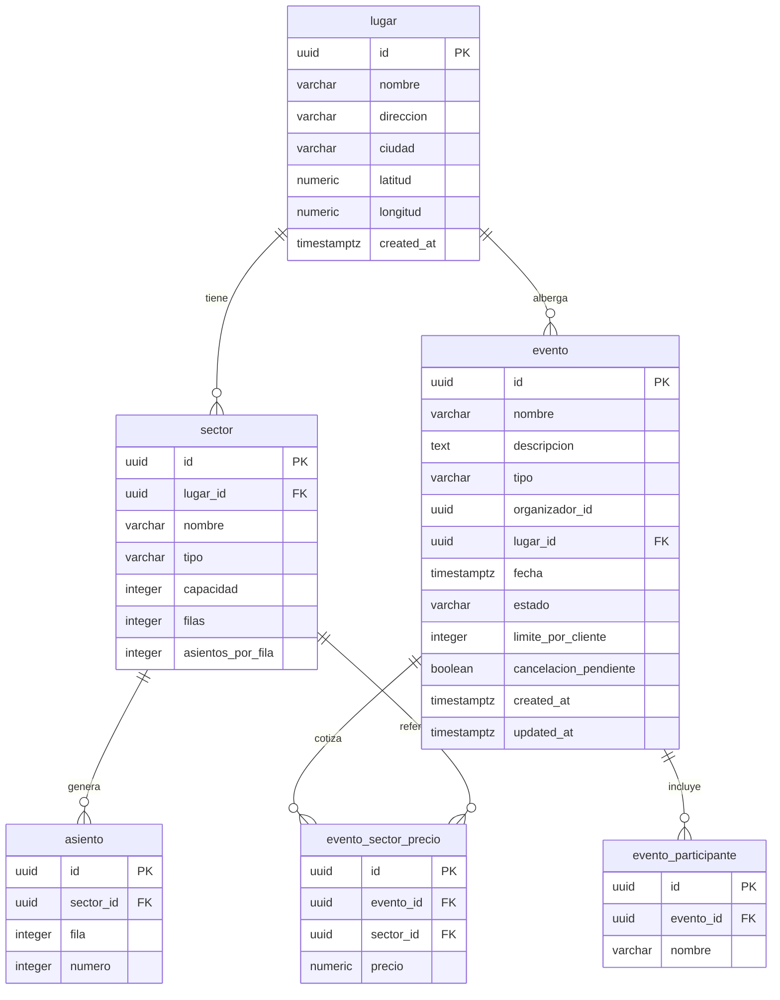
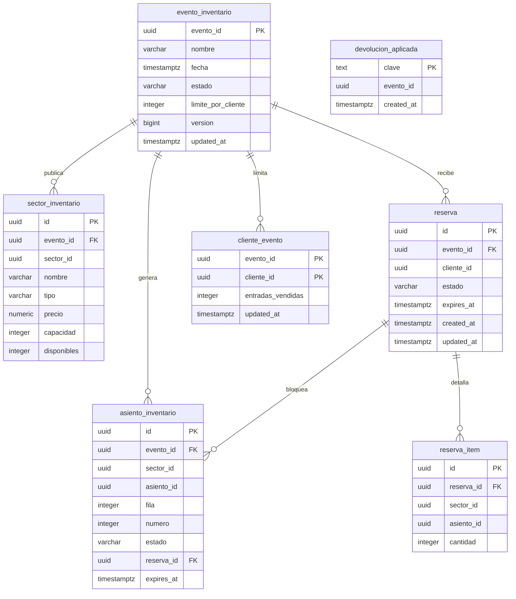
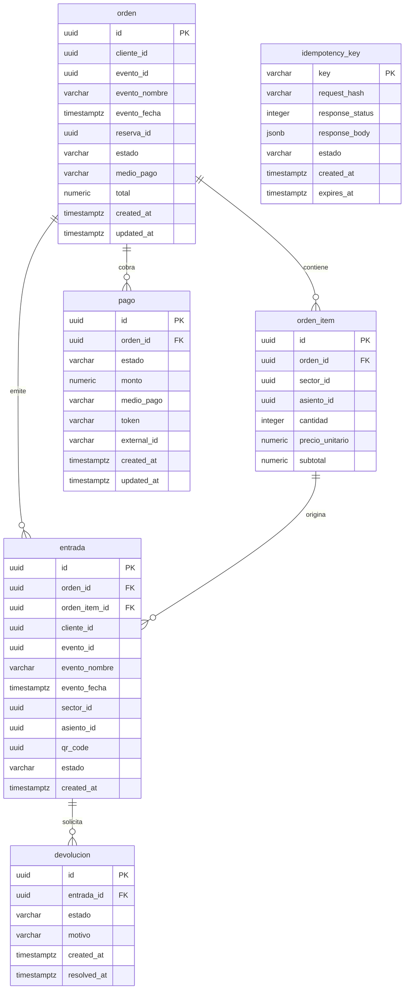

# Modelo de datos por microservicio

ER y colecciones de las bases de la Entrega 1 y la Entrega 2. Cada servicio es dueño de su esquema y no hay claves foráneas entre bases: la integración usa IDs, snapshots y eventos de dominio.

## 1. catalog-service (`catalog_db`)

Fuente de verdad: migraciones V1 y V3 a V8 en [`catalog-service/src/main/resources/db/migration/`](../catalog-service/src/main/resources/db/migration/); los cambios de la Entrega 2 se detallan al final de esta sección.

### Reglas y constraints

| Tabla | Clave / relación | Reglas en Flyway |
|---|---|---|
| `lugar` | `id` PK | `latitud` entre -90 y 90; `longitud` entre -180 y 180; textos no nulos |
| `sector` | `lugar_id` → `lugar.id` (`ON DELETE CASCADE`) | `tipo` en `NUMERADO`/`NO_NUMERADO`; `capacidad > 0`; `UNIQUE (lugar_id, nombre)`; numerados exigen `filas` y `asientos_por_fila` mayores a 0; no numerados los dejan en `NULL`; V4 exige `capacidad = filas * asientos_por_fila` para numerados |
| `asiento` | `sector_id` → `sector.id` (`ON DELETE CASCADE`) | `fila > 0`, `numero > 0`; `UNIQUE (sector_id, fila, numero)` |
| `evento` | `lugar_id` → `lugar.id`; `organizador_id` es un UUID externo | `tipo` en el enum de eventos (V4); `estado` en `BORRADOR`/`PUBLICADO`/`AGOTADO`/`CANCELADO`/`FINALIZADO`; `limite_por_cliente > 0`; `cancelacion_pendiente` default `false` |
| `evento_participante` | `evento_id` → `evento.id` (`ON DELETE CASCADE`) | `nombre` no nulo; índice por `(evento_id, nombre)` |
| `evento_sector_precio` | `evento_id` → `evento.id` (`ON DELETE CASCADE`); `sector_id` → `sector.id` | `precio >= 0`; `UNIQUE (evento_id, sector_id)` garantiza un precio por sector |

Índices: `idx_evento_busqueda` para búsqueda por estado/fecha/tipo/organizador/lugar y `idx_evento_cancelacion_pendiente` parcial para el scheduler.

### Entidades solapadas con otras bases

Catalog es dueño de estos IDs; inventory y orders guardan copias o referencias sin FK entre bases:

- `evento.id`: clave del snapshot de publicación en inventory y del snapshot de la orden.
- `sector.id` y `asiento.id`: referenciados por el inventario y por los ítems de la orden.
- `evento.nombre`, `evento.fecha`, `sector.id`, `asiento.id` y precio unitario: orders guarda un snapshot al crear la orden para validar devoluciones sin consultar catalog.
- `organizador_id`: se toma de `X-User-Id`; la identidad no vive en `catalog_db`.
- `lugar`, `sector`, `asiento`, `evento_participante` y `evento_sector_precio` son exclusivos de catalog.

### Validación contra el código

- Las entidades JPA de `catalog-service/src/main/java/.../dominio` mapean las mismas columnas (`ddl-auto: validate` en runtime).
- Se corrigió `Evento.updatedAt` para que `@PreUpdate` pueda persistir el cambio; antes la columna era `updatable = false` y quedaba congelada tras el alta.
- V4 refuerza en la base las reglas de `evento.tipo` y la capacidad de sectores numerados que antes solo validaba la aplicación.
- `EventoBusquedaIntegrationTest` valida el esquema real con PostgreSQL en CI (Testcontainers).

### Entrega 2: alta demanda, edición y outbox (V5–V8)

| Objeto | Tipo | Cambio | Para qué |
|---|---|---|---|
| `evento.alta_demanda` | columna | `BOOLEAN NOT NULL DEFAULT FALSE` | Habilita la fila virtual al publicar (tarea 3.1) |
| `evento.inventario_version` | columna | `BIGINT NOT NULL DEFAULT 0`, `CHECK >= 0`; los eventos ya publicados arrancan en 1 | Versiona el snapshot y descarta ediciones viejas |
| `outbox_event` | tabla | `id`, `event_id` único, `type`, `aggregate_id`, `occurred_at`, `correlation_id`, `version`, `payload` JSONB, `status` (`PENDING`/`PUBLISHED`/`FAILED`), `attempts`, `next_attempt_at`, `published_at`, `last_error`, `created_at` | Publicación transaccional de `evento.publicado`, `evento.actualizado` y `evento.cancelado` (V6 y V8) |
| `audit_log` | tabla | `id`, `evento_id`, `accion`, `usuario_id`, `usuario_rol`, `resultado` (`EXITOSO`/`RECHAZADO`), `detalle`, `correlation_id`, `created_at` | Bitácora de publicación, edición y cancelación (V7) |

Índices nuevos: `idx_outbox_event_status_next`, `idx_outbox_event_aggregate`,
`idx_audit_log_evento_created` e `idx_audit_log_correlation`. El `CHECK` de
`outbox_event.status` se amplió en V8 para admitir `FAILED` sin hacer rollback del lote.

## 2. inventory-service (`inventory_db`)

Fuente de verdad: migraciones V1 y V3 a V5 en [`inventory-service/src/main/resources/db/migration/`](../inventory-service/src/main/resources/db/migration/); los cambios de la Entrega 2 se detallan al final de esta sección.

### Reglas y constraints

| Tabla | Clave / relación | Reglas en Flyway |
|---|---|---|
| `evento_inventario` | `evento_id` PK (ID de catalog) | `estado` en `PUBLICADO`/`AGOTADO`/`CANCELADO`/`FINALIZADO`; `limite_por_cliente > 0`; `version` para el upsert idempotente de publicación |
| `sector_inventario` | `evento_id` → `evento_inventario` (`ON DELETE CASCADE`); `UNIQUE (evento_id, sector_id)` | `tipo` en `NUMERADO`/`NO_NUMERADO`; `precio >= 0`; `capacidad > 0`; numerados tienen `disponibles = NULL` y no numerados `0 <= disponibles <= capacidad` |
| `asiento_inventario` | `evento_id` → `evento_inventario` (`ON DELETE CASCADE`); `reserva_id` → `reserva.id`; `UNIQUE (evento_id, asiento_id)` | `fila > 0`, `numero > 0`; `estado` en `LIBRE`/`RESERVADO`/`VENDIDO`; coherencia: `LIBRE` sin reserva ni vencimiento, `RESERVADO` con ambos, `VENDIDO` con reserva |
| `reserva` | `evento_id` → `evento_inventario`; `cliente_id` es un UUID externo | `estado` en `VIGENTE`/`CONFIRMADA`/`LIBERADA`/`VENCIDA`; `expires_at` obligatorio |
| `reserva_item` | `reserva_id` → `reserva` (`ON DELETE CASCADE`) | `cantidad > 0`; `UNIQUE (reserva_id, sector_id, asiento_id)` evita duplicar el mismo lugar |
| `cliente_evento` | PK `(evento_id, cliente_id)`; `evento_id` → `evento_inventario` | `entradas_vendidas >= 0`; es el contador del límite por cliente |
| `devolucion_aplicada` | `clave` PK | Idempotencia de `POST /internal/returns`: la misma clave no repone la zona dos veces |

Índices: `idx_asiento_inventario_sector` para el mapa de asientos, `idx_reserva_vencimiento` para el scheduler de vencimiento e `idx_reserva_cliente` para el conteo del límite.

### Entidades solapadas con otras bases

- `evento_id`: es el `evento.id` de catalog. Inventory guarda `nombre`, `fecha` y `limite_por_cliente` como snapshot de publicación; no hay FK contra `catalog_db`.
- `sector_id` y `asiento_id`: son los IDs de catalog; se guardan en `sector_inventario` y `asiento_inventario` para mapear la disponibilidad sin consultar catalog en cada reserva.
- `cliente_id`: identidad externa que llega por `X-User-Id`; no existe tabla de usuarios en ninguna base.
- `reserva.id`: lo consume orders como `reserva_id` de la orden (referencia lógica, sin FK entre bases).
- `devolucion_aplicada` es exclusiva de inventory y materializa la idempotencia de las devoluciones internas que llama orders.

### Validación contra el código

- Las entidades JPA de `inventory-service/src/main/java/.../dominio` mapean las mismas columnas con `ddl-auto: validate`.
- `ConcurrenciaPostgresTest` levanta PostgreSQL 16 real con Testcontainers y valida locks, constraints y la unicidad de la reserva.
- `ReservaServiceTest` cubre límite, vencimiento, confirmación, liberación y devolución idempotente.

### Entrega 2: alta demanda, fila y cancelación (V4–V5)

| Objeto | Tipo | Cambio | Para qué |
|---|---|---|---|
| `evento_inventario.alta_demanda` | columna | `BOOLEAN NOT NULL DEFAULT FALSE` | Exigir el token de fila solo en esos eventos |
| `reserva.queue_jti` | columna | `UUID` nullable | `jti` del token de fila que autorizó la reserva; no hay unique porque el token se reutiliza hasta su `exp` |
| `reserva.origen` | columna | `VARCHAR(20) NOT NULL DEFAULT 'DIRECTA'`, `CHECK (DIRECTA, FILA)` | Distingue la reserva directa de la que llegó por la fila |
| `reserva.estado` | constraint | V5 agrega `CANCELADA` a `VIGENTE`, `CONFIRMADA`, `LIBERADA` y `VENCIDA` | Cancelación del cliente sin confundirla con la liberación del pago rechazado |

## 3. orders-service (`orders_db`)

Fuente de verdad: migraciones V1 a V5 en [`orders-service/src/main/resources/db/migration/`](../orders-service/src/main/resources/db/migration/); los cambios de la Entrega 2 se detallan al final de esta sección.

### Reglas y constraints

| Tabla | Clave / relación | Reglas en Flyway |
|---|---|---|
| `orden` | `id` PK; `reserva_id` es el ID de inventory | `estado` en `PENDIENTE_PAGO`/`PAGADA`/`RECHAZADA`/`ERROR_PAGO`/`REINTEGRO_PENDIENTE`; `total >= 0`; guarda snapshot de `evento_nombre` y `evento_fecha` |
| `orden_item` | `orden_id` → `orden` (`ON DELETE CASCADE`) | `cantidad > 0`; `precio_unitario >= 0`; `subtotal >= 0`; `asiento_id` es `NULL` para zonas no numeradas |
| `pago` | `orden_id` → `orden` | `estado` en `PENDIENTE`/`APROBADO`/`RECHAZADO`/`REINTEGRADO`; `monto >= 0`; `medio_pago` obligatorio |
| `entrada` | `orden_id` → `orden`; `orden_item_id` → `orden_item` | `qr_code` UUID `UNIQUE`; `estado` en `VALIDA`/`UTILIZADA`/`DEVUELTA`/`EN_REINTEGRO`; snapshot de evento, sector y asiento |
| `devolucion` | `entrada_id` → `entrada` | `estado` en `PENDIENTE`/`PROCESANDO`/`APROBADA`/`RECHAZADA`; índice único parcial `uq_devolucion_abierta`: una sola devolución abierta por entrada |
| `idempotency_key` | `key` PK | `estado` en `EN_PROCESO`/`COMPLETADA`; `request_hash` detecta cuerpo distinto; `response_status`/`response_body` guardan la respuesta original; `expires_at` para limpieza |

La migración 6.1 agrega a `orden` el snapshot `evento_tipo`, `evento_artistas` y
`evento_ciudad` (además de los existentes `evento_nombre`/`evento_fecha`) para publicar
`orden.pagada` completo, según ADR-017 y [`eventos.md`](eventos.md). El origen es el snapshot
de catalog hacia inventory, que inventory devuelve en la reserva.

Índices: `idx_orden_cliente` (listado propio), `idx_orden_evento` (cancelación de evento), `idx_pago_orden`, `idx_entrada_cliente`, `idx_entrada_evento`, `idx_devolucion_estado` e `idx_idempotency_expira`.

### Entidades solapadas con otras bases

- `evento_id`, `sector_id`, `asiento_id`, `cliente_id` y `reserva_id` son referencias lógicas a catalog, inventory o a la identidad; no hay FK entre bases.
- `orden` y `entrada` guardan snapshot de `evento_nombre` y `evento_fecha`, y `orden_item` guarda `precio_unitario`, para resolver devoluciones y consultas sin depender de catalog.
- `pago`, `entrada`, `devolucion` e `idempotency_key` son exclusivas de orders. Inventory solo conoce `reserva.id` y las devoluciones internas por `referencia`.

### Validación contra el código

- Las entidades JPA de `orders-service/src/main/java/.../dominio` mapean las mismas columnas con `ddl-auto: validate`.
- `OrderIdempotencyIntegrationTest` valida el esquema y la idempotencia concurrente contra PostgreSQL real (Testcontainers).
- `DevolucionServiceTest`, `OrderQueryServiceTest` y `TicketServiceTest` cubren las transiciones y el aislamiento por cliente.

### Entrega 2: saga, outbox, acceso QR y reportes (V5)

| Objeto | Tipo | Cambio | Para qué |
|---|---|---|---|
| `orden.cliente_email` | columna | `VARCHAR(320)` nullable | Notificación y reporte del comprador |
| `orden.evento_organizador_id` | columna | `UUID` nullable | Reportes por organizador dueño |
| `orden.sector_nombre` | columna | `VARCHAR(120)` nullable | Reporte por sector, incluso en zonas no numeradas |
| `orden.evento_tipo` | columna | `VARCHAR(40)` nullable | Payload de `orden.pagada` y recomendaciones |
| `orden.evento_artistas` | columna | `JSONB NOT NULL DEFAULT '[]'` | Snapshot de artistas (ADR-017) |
| `orden.evento_ciudad` | columna | `VARCHAR(120)` nullable | Ranking por ciudad |
| `entrada.used_at` / `entrada.used_by` | columnas | `TIMESTAMPTZ` / `UUID` nullable | Control de acceso QR y uso único |
| `saga_compra` | tabla | `orden_id` PK, `paso` (`RESERVA_VALIDADA`…`ENTRADAS_EMITIDAS`), `estado` (`EN_PROCESO`/`COMPLETADA`/`COMPENSANDO`/`COMPENSADA`/`FALLIDA`), `intentos`, `ultimo_error`, fechas | Máquina de estados de la compra (tarea 6.2) |
| `outbox_event` | tabla | Mismo esquema que catalog y `orden` como agregado | `orden.pagada`, `orden.reintegrada` y `devolucion.aprobada` en la misma transacción (tarea 6.3) |
| `audit_log` | tabla | `operacion`, `entidad`, `entidad_id`, `usuario_id`, `rol`, `resultado` (`EXITOSO`/`RECHAZADO`/`ERROR`), `detalle` JSONB, `correlation_id` | Bitácora de compra, devolución, cancelación y acceso QR (tarea 9.3) |

Índices nuevos: `idx_entrada_evento_sector_estado`, `idx_orden_evento_estado`,
`idx_saga_compra_estado`, `idx_outbox_event_status_next`, `idx_outbox_event_aggregate`,
`idx_audit_log_entidad`, `idx_audit_log_correlacion` e `idx_audit_log_created`.

## 4. recommendation-service (`recommendation_db`, MongoDB)

MongoDB se usa para preferencias e historial porque los documentos tienen listas variables
(`tipos[]`, `artistas[]`) y las recomendaciones necesitan agregaciones por cliente, evento,
tipo, artista y ciudad sin migraciones rígidas.

| Colección | Documento | Índices | Uso |
|---|---|---|---|
| `preferencias` | `{_id, clienteId, tipos[], artistas[], ciudad, actualizadoEn}` | único `clienteId` (`uk_preferencias_cliente`); `ciudad` (`idx_preferencias_ciudad`) | Gustos declarados por el cliente; como máximo un documento por cliente |
| `historial_compras` | `{_id, eventId, eventoId, clienteId, tipo, artistas[], ciudad, fechaEvento, ordenId, registradoEn}` | único `(eventId, clienteId, eventoId)` (`uk_historial_evento_cliente_evento`); `(clienteId, fechaEvento)`; `(eventoId, clienteId)` | Compras pagadas para recomendaciones y co-compra; idempotencia por `eventId` |
| `eventos_vistos` | `{_id: eventoId, nombre, tipo, artistas[], ciudad, fechaEvento, estado, actualizadoEn}` | `(ciudad, tipo)`; `fechaEvento` | Snapshot mínimo para fallback de populares y motivos sin consultar catalog en cada request |

Índices y seed se crean al arrancar el servicio (`MongoIndexInitializer` y
`RecommendationSeedRunner`); el seed usa `$setOnInsert` para no pisar cambios del cliente.
`spring.data.mongodb.auto-index-creation` está deshabilitado.

### Reglas y constraints

- Un `clienteId` tiene como máximo un documento en `preferencias`; el índice único lo garantiza.
- El historial no duplica una compra: la clave `(eventId, clienteId, eventoId)` es única.
- `eventos_vistos._id` es el `eventoId` del catálogo.
- El historial se alimenta con `orden.pagada` mediante un upsert con `$setOnInsert`; un
  duplicado del mismo `eventId` no cambia el documento y `orden.reintegrada` no se registra.
- El servicio solo lee y escribe su propia base; los datos de eventos llegan por eventos de
  dominio y los candidatos publicados se consultan a catalog en la tarea 7.4.

### Validación contra el código

- `MongoIndexInitializer` crea los índices de la tabla anterior.
- `RecommendationMongoIntegrationTest` (Testcontainers `mongo:7`) verifica índices, seed,
  preferencias y el registro idempotente del historial.
- `RecommendationRabbitIntegrationTest` (Testcontainers `mongo:7` + `rabbitmq:3.13`) verifica
  que `orden.pagada` se consuma una sola vez y que un reintegro no entre al historial.
- `PreferenceServiceTest`, `RecommendationServiceTest`, `HistorialServiceTest` y los tests de
  controllers cubren validación, ranking, fallback y ownership.

## 5. queue-service (Redis)

La fila virtual no usa una base relacional: Redis 7 es el almacén primario y la fuente de
verdad mientras la fila está abierta. Se eligió Redis por las operaciones atómicas de sorted
set y scripts Lua (posición, ingreso idempotente y tandas), que serían costosas en SQL bajo
concurrencia. La persistencia es AOF (`appendonly yes` en el compose); si Redis pierde los
datos, el ingreso responde `409 QUEUE_NOT_OPEN` y no se emiten tokens.

| Clave | Tipo | Contenido | Uso |
|---|---|---|---|
| `queue:{eventoId}:waiting` | sorted set | `userId` → score = `epochMillis + seq/1e6` | Orden FIFO; `ZADD NX` evita duplicados y `ZRANK` da la posición |
| `queue:{eventoId}:state` | hash | `estado` (`ABIERTA`/`CERRADA`), `batchSize`, `intervaloSegundos`, `version`, `ultimaTanda`, `motivo`, `cerradaEn` | Configuración y estado de la fila |
| `queue:{eventoId}:seq` | contador | `INCR` por ingreso | Desempata llegadas en el mismo milisegundo sin perder el orden |
| `queue:{eventoId}:admitted` | hash | `userId` → token JWT y `exp`, `PENDIENTE` o `CERRADA` | Marca de la tanda; el scheduler firma los `PENDIENTE` y limpia vencidos |
| `queue:open` | set | `eventoId` de las filas abiertas | Índice para que el scheduler no recorra todas las claves |

Reglas:

- La habilitación es por tandas: cada `intervaloSegundos` (default 30) salen los primeros
  `batchSize` (default 50) en orden FIFO. La misma persona no sale dos veces.
- El token es un JWT HS256 con `eventId`, `sub`, `jti`, `exp` y `type=QUEUE`, TTL de 5
  minutos. No se guarda en una tabla ni se consume: vale hasta `exp` y se puede reutilizar.
  Inventory lo valida en local con la misma clave.
- Cerrar la fila no borra las claves: cambia `estado` a `CERRADA`, saca el evento de
  `queue:open` y marca `CERRADA` a los habilitados. Quien estaba en espera consulta ese
  estado.
- `queue:{eventoId}:state` no tiene TTL: el cierre es explícito y se conserva para responder
  `409 QUEUE_CLOSED`/`409 QUEUE_NOT_OPEN` con un motivo estable.

### Validación contra el código

- `FilaRedisTest` (Testcontainers `redis:7-alpine`) cubre ingreso, reingreso, posición y
  cierre; `TandaTokenTest` cubre las tandas y el vencimiento del token.
- `CierreFilaTest` valida el cierre y la recuperación con AOF; `QueueControllerRolTest`
  verifica que solo `CLIENT` entra y consulta.
- Los scripts Lua viven en `queue-service/src/main/resources/redis/`.

## 6. notification-service (`notification_db`)

PostgreSQL se usa para la bandeja de notificaciones y la proyección de compradores. La
deduplicación y los reintentos necesitan transacciones y consultas por estado; el envío real
es un efecto externo que se modela como un estado persistido.

| Tabla | Columnas | Claves e índices | Uso |
|---|---|---|---|
| `notificacion` | `id`, `event_id`, `tipo`, `destinatario_id`, `destinatario_email`, `asunto`, `contenido`, `estado`, `intentos`, `proximo_reintento`, `ultimo_error`, `correlation_id`, `created_at`, `updated_at`, `enviada_at` | PK `id`; único `(event_id, tipo, destinatario_id)`; `CHECK` de `estado` (`PENDIENTE`/`ENVIADA`/`FALLIDA`); `(destinatario_id, created_at DESC)`; `(estado, proximo_reintento)` | Bandeja y ciclo de envío; el único es la idempotencia por evento, tipo y destinatario |
| `comprador_evento` | `id`, `evento_id`, `cliente_id`, `cliente_email`, `evento_nombre`, `evento_fecha`, `evento_ciudad`, `updated_at` | PK `id`; único `(evento_id, cliente_id)`; índice `evento_id` | Proyección para avisar cancelaciones y cambios a quienes compraron |

Reglas:

- `crearYEnviar` intenta el envío de inmediato. Un éxito deja `ENVIADA`; un fallo suma
  `intentos`, guarda `ultimo_error` y programa `proximo_reintento` con backoff lineal
  (`NOTIFICATION_BACKOFF_SECONDS × intentos`). Al llegar a `NOTIFICATION_MAX_ATTEMPTS` pasa a
  `FALLIDA` y no se reintenta.
- La consulta `GET /api/notifications` filtra por `destinatario_id = X-User-Id`; el detalle de
  otro cliente responde `403` y una notificación inexistente `404`.
- Las migraciones son `V1__init.sql` (solo inicializa Flyway), `V2__notificacion.sql` y
  `V3__comprador_evento.sql`. No hay FK contra otras bases: `destinatario_id`, `cliente_id`,
  `evento_id` y `event_id` son referencias lógicas.

### Validación contra el código

- `NotificationServiceTest` cubre envío, reintentos con backoff, `FALLIDA` e idempotencia por
  evento+tipo+destinatario; `OrdenPagadaListenerTest` y `EventoNotificacionListenerTest`
  cubren los consumidores y la DLQ.
- `NotificationServiceApplicationTests` (Testcontainers PostgreSQL + RabbitMQ) valida el
  esquema con Flyway y el health de base y broker.
- `OpenApiExportTest` exporta `openapi/notification-openapi.json` desde los controllers.

## 7. Entidades solapadas entre bases

| Dato | Dueño | Copia / referencia | Para qué |
|---|---|---|---|
| `evento.id` | catalog | `evento_inventario.evento_id`, `orden.evento_id`, `entrada.evento_id`, `outbox_event.aggregate_id` | Publicación, reserva, compra y eventos de dominio |
| `sector.id` | catalog | `sector_inventario.sector_id`, `orden_item.sector_id`, `entrada.sector_id` | Disponibilidad y snapshot de compra |
| `asiento.id` | catalog | `asiento_inventario.asiento_id`, `orden_item.asiento_id`, `entrada.asiento_id` | No doble venta y QR por lugar |
| `evento.nombre` / `evento.fecha` | catalog | `evento_inventario`, `orden`, `entrada`, `comprador_evento` | Consultas, devoluciones y avisos sin llamada cruzada |
| `evento.tipo` / `artistas` / `ciudad` | catalog | `evento_inventario`, `orden` (migración 6.1), `historial_compras` | Ranking de recomendaciones y payload de `orden.pagada` |
| `reserva.id` | inventory | `orden.reserva_id` | Confirmar, liberar o devolver la reserva |
| `reserva.queue_jti` | queue | token de fila validado por inventory | Autoriza la reserva de un evento de alta demanda sin consultar queue en el camino crítico |
| `cliente_id` / `organizador_id` | identidad (fuera de las bases) | `reserva.cliente_id`, `orden.cliente_id`, `entrada.cliente_id`, `evento.organizador_id`, `preferencias.clienteId`, `historial_compras.clienteId`, `notificacion.destinatario_id`, `comprador_evento.cliente_id`, `audit_log.usuario_id` | Autorización, consultas propias y reportes |
| `event_id` (sobre de eventos) | productor (catalog/orders) | `notificacion.event_id`, `outbox_event.event_id`, historial de recommendation | Idempotencia de consumidores y trazabilidad del outbox |
| `evento.id`, `tipo`, `artistas`, `ciudad`, `fecha` | catalog | `eventos_vistos`, `historial_compras` y eventos de dominio | Recomendaciones y motivos sin llamada cruzada |

Regla de integración: ninguna base tiene FK contra otra. La consistencia se mantiene con snapshots inmutables al momento de la compra, un outbox transaccional por productor y endpoints internos idempotentes (`publicar`, `confirm`, `release`, `returns`, `cancel`). Los diagramas de flujo están en [`arquitectura.md`](arquitectura.md) y las decisiones en [`decisiones.md`](decisiones.md).
