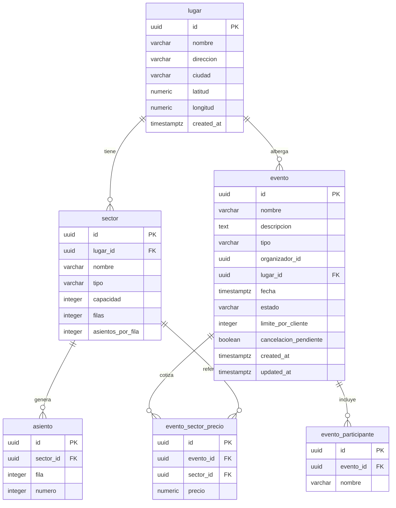
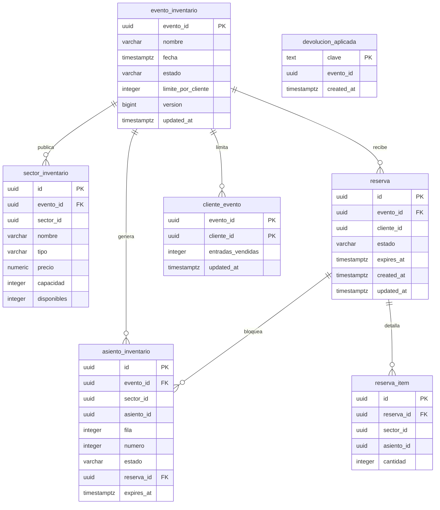
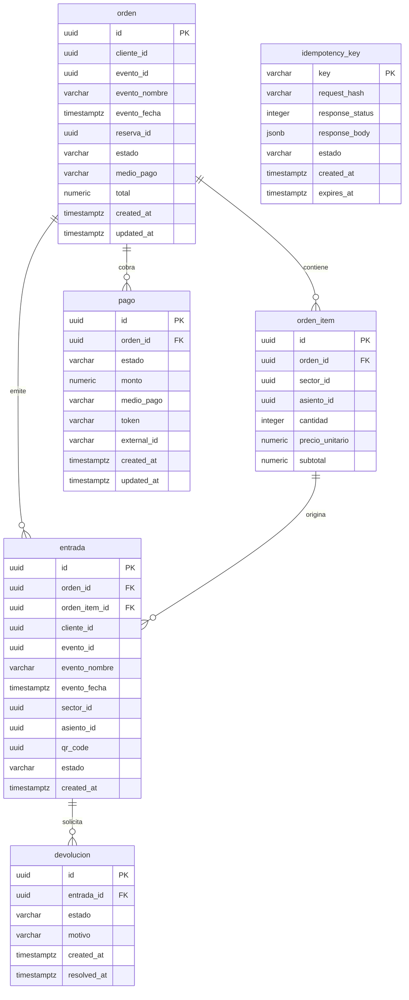

# Modelo de datos por microservicio

ER de las bases de la Entrega 1. Cada servicio es dueño de su esquema y no hay claves foráneas entre bases: la integración usa IDs y snapshots.

## 1. catalog-service (`catalog_db`)

Fuente de verdad: migraciones [`V1__init.sql`](../catalog-service/src/main/resources/db/migration/V1__init.sql), [`V3__evento_cancelacion_pendiente.sql`](../catalog-service/src/main/resources/db/migration/V3__evento_cancelacion_pendiente.sql) y [`V4__constraints_integridad.sql`](../catalog-service/src/main/resources/db/migration/V4__constraints_integridad.sql).

### Reglas y constraints

| Tabla | Clave / relación | Reglas en Flyway |
|---|---|---|
| `lugar` | `id` PK | `latitud` entre -90 y 90; `longitud` entre -180 y 180; textos no nulos |
| `sector` | `lugar_id` → `lugar.id` (`ON DELETE CASCADE`) | `tipo` en `NUMERADO`/`NO_NUMERADO`; `capacidad > 0`; `UNIQUE (lugar_id, nombre)`; numerados exigen `filas` y `asientos_por_fila` mayores a 0; no numerados los dejan en `NULL`; V4 exige `capacidad = filas * asientos_por_fila` para numerados |
| `asiento` | `sector_id` → `sector.id` (`ON DELETE CASCADE`) | `fila > 0`, `numero > 0`; `UNIQUE (sector_id, fila, numero)` |
| `evento` | `lugar_id` → `lugar.id`; `organizador_id` es un UUID externo | `tipo` en el enum de eventos (V4); `estado` en `BORRADOR`/`PUBLICADO`/`AGOTADO`/`CANCELADO`/`FINALIZADO`; `limite_por_cliente > 0`; `cancelacion_pendiente` default `false` |
| `evento_participante` | `evento_id` → `evento.id` (`ON DELETE CASCADE`) | `nombre` no nulo; índice por `(evento_id, nombre)` |
| `evento_sector_precio` | `evento_id` → `evento.id` (`ON DELETE CASCADE`); `sector_id` → `sector.id` | `precio >= 0`; `UNIQUE (evento_id, sector_id)` garantiza un precio por sector |

Índices: `idx_evento_busqueda` para búsqueda por estado/fecha/tipo/organizador/lugar y `idx_evento_cancelacion_pendiente` parcial para el scheduler.

### Entidades solapadas con otras bases

Catalog es dueño de estos IDs; inventory y orders guardan copias o referencias sin FK entre bases:

- `evento.id`: clave del snapshot de publicación en inventory y del snapshot de la orden.
- `sector.id` y `asiento.id`: referenciados por el inventario y por los ítems de la orden.
- `evento.nombre`, `evento.fecha`, `sector.id`, `asiento.id` y precio unitario: orders guarda un snapshot al crear la orden para validar devoluciones sin consultar catalog.
- `organizador_id`: se toma de `X-User-Id`; la identidad no vive en `catalog_db`.
- `lugar`, `sector`, `asiento`, `evento_participante` y `evento_sector_precio` son exclusivos de catalog.

### Validación contra el código

- Las entidades JPA de `catalog-service/src/main/java/.../dominio` mapean las mismas columnas (`ddl-auto: validate` en runtime).
- Se corrigió `Evento.updatedAt` para que `@PreUpdate` pueda persistir el cambio; antes la columna era `updatable = false` y quedaba congelada tras el alta.
- V4 refuerza en la base las reglas de `evento.tipo` y la capacidad de sectores numerados que antes solo validaba la aplicación.
- `EventoBusquedaIntegrationTest` valida el esquema real con PostgreSQL en CI (Testcontainers).

## 2. inventory-service (`inventory_db`)

Fuente de verdad: migraciones [`V1__init.sql`](../inventory-service/src/main/resources/db/migration/V1__init.sql) y [`V3__devolucion_aplicada.sql`](../inventory-service/src/main/resources/db/migration/V3__devolucion_aplicada.sql).

### Reglas y constraints

| Tabla | Clave / relación | Reglas en Flyway |
|---|---|---|
| `evento_inventario` | `evento_id` PK (ID de catalog) | `estado` en `PUBLICADO`/`AGOTADO`/`CANCELADO`/`FINALIZADO`; `limite_por_cliente > 0`; `version` para el upsert idempotente de publicación |
| `sector_inventario` | `evento_id` → `evento_inventario` (`ON DELETE CASCADE`); `UNIQUE (evento_id, sector_id)` | `tipo` en `NUMERADO`/`NO_NUMERADO`; `precio >= 0`; `capacidad > 0`; numerados tienen `disponibles = NULL` y no numerados `0 <= disponibles <= capacidad` |
| `asiento_inventario` | `evento_id` → `evento_inventario` (`ON DELETE CASCADE`); `reserva_id` → `reserva.id`; `UNIQUE (evento_id, asiento_id)` | `fila > 0`, `numero > 0`; `estado` en `LIBRE`/`RESERVADO`/`VENDIDO`; coherencia: `LIBRE` sin reserva ni vencimiento, `RESERVADO` con ambos, `VENDIDO` con reserva |
| `reserva` | `evento_id` → `evento_inventario`; `cliente_id` es un UUID externo | `estado` en `VIGENTE`/`CONFIRMADA`/`LIBERADA`/`VENCIDA`; `expires_at` obligatorio |
| `reserva_item` | `reserva_id` → `reserva` (`ON DELETE CASCADE`) | `cantidad > 0`; `UNIQUE (reserva_id, sector_id, asiento_id)` evita duplicar el mismo lugar |
| `cliente_evento` | PK `(evento_id, cliente_id)`; `evento_id` → `evento_inventario` | `entradas_vendidas >= 0`; es el contador del límite por cliente |
| `devolucion_aplicada` | `clave` PK | Idempotencia de `POST /internal/returns`: la misma clave no repone la zona dos veces |

Índices: `idx_asiento_inventario_sector` para el mapa de asientos, `idx_reserva_vencimiento` para el scheduler de vencimiento e `idx_reserva_cliente` para el conteo del límite.

### Entidades solapadas con otras bases

- `evento_id`: es el `evento.id` de catalog. Inventory guarda `nombre`, `fecha` y `limite_por_cliente` como snapshot de publicación; no hay FK contra `catalog_db`.
- `sector_id` y `asiento_id`: son los IDs de catalog; se guardan en `sector_inventario` y `asiento_inventario` para mapear la disponibilidad sin consultar catalog en cada reserva.
- `cliente_id`: identidad externa que llega por `X-User-Id`; no existe tabla de usuarios en ninguna base.
- `reserva.id`: lo consume orders como `reserva_id` de la orden (referencia lógica, sin FK entre bases).
- `devolucion_aplicada` es exclusiva de inventory y materializa la idempotencia de las devoluciones internas que llama orders.

### Validación contra el código

- Las entidades JPA de `inventory-service/src/main/java/.../dominio` mapean las mismas columnas con `ddl-auto: validate`.
- `ConcurrenciaPostgresTest` levanta PostgreSQL 16 real con Testcontainers y valida locks, constraints y la unicidad de la reserva.
- `ReservaServiceTest` cubre límite, vencimiento, confirmación, liberación y devolución idempotente.

## 3. orders-service (`orders_db`)

Fuente de verdad: migración [`V1__init.sql`](../orders-service/src/main/resources/db/migration/V1__init.sql).

### Reglas y constraints

| Tabla | Clave / relación | Reglas en Flyway |
|---|---|---|
| `orden` | `id` PK; `reserva_id` es el ID de inventory | `estado` en `PENDIENTE_PAGO`/`PAGADA`/`RECHAZADA`/`ERROR_PAGO`/`REINTEGRO_PENDIENTE`; `total >= 0`; guarda snapshot de `evento_nombre` y `evento_fecha` |
| `orden_item` | `orden_id` → `orden` (`ON DELETE CASCADE`) | `cantidad > 0`; `precio_unitario >= 0`; `subtotal >= 0`; `asiento_id` es `NULL` para zonas no numeradas |
| `pago` | `orden_id` → `orden` | `estado` en `PENDIENTE`/`APROBADO`/`RECHAZADO`/`REINTEGRADO`; `monto >= 0`; `medio_pago` obligatorio |
| `entrada` | `orden_id` → `orden`; `orden_item_id` → `orden_item` | `qr_code` UUID `UNIQUE`; `estado` en `VALIDA`/`UTILIZADA`/`DEVUELTA`/`EN_REINTEGRO`; snapshot de evento, sector y asiento |
| `devolucion` | `entrada_id` → `entrada` | `estado` en `PENDIENTE`/`PROCESANDO`/`APROBADA`/`RECHAZADA`; índice único parcial `uq_devolucion_abierta`: una sola devolución abierta por entrada |
| `idempotency_key` | `key` PK | `estado` en `EN_PROCESO`/`COMPLETADA`; `request_hash` detecta cuerpo distinto; `response_status`/`response_body` guardan la respuesta original; `expires_at` para limpieza |

Índices: `idx_orden_cliente` (listado propio), `idx_orden_evento` (cancelación de evento), `idx_pago_orden`, `idx_entrada_cliente`, `idx_entrada_evento`, `idx_devolucion_estado` e `idx_idempotency_expira`.

### Entidades solapadas con otras bases

- `evento_id`, `sector_id`, `asiento_id`, `cliente_id` y `reserva_id` son referencias lógicas a catalog, inventory o a la identidad; no hay FK entre bases.
- `orden` y `entrada` guardan snapshot de `evento_nombre` y `evento_fecha`, y `orden_item` guarda `precio_unitario`, para resolver devoluciones y consultas sin depender de catalog.
- `pago`, `entrada`, `devolucion` e `idempotency_key` son exclusivas de orders. Inventory solo conoce `reserva.id` y las devoluciones internas por `referencia`.

### Validación contra el código

- Las entidades JPA de `orders-service/src/main/java/.../dominio` mapean las mismas columnas con `ddl-auto: validate`.
- `OrderIdempotencyIntegrationTest` valida el esquema y la idempotencia concurrente contra PostgreSQL real (Testcontainers).
- `DevolucionServiceTest`, `OrderQueryServiceTest` y `TicketServiceTest` cubren las transiciones y el aislamiento por cliente.

## 4. Entidades solapadas entre bases

| Dato | Dueño | Copia / referencia | Para qué |
|---|---|---|---|
| `evento.id` | catalog | `evento_inventario.evento_id`, `orden.evento_id`, `entrada.evento_id` | Publicación, reserva y compra |
| `sector.id` | catalog | `sector_inventario.sector_id`, `orden_item.sector_id`, `entrada.sector_id` | Disponibilidad y snapshot de compra |
| `asiento.id` | catalog | `asiento_inventario.asiento_id`, `orden_item.asiento_id`, `entrada.asiento_id` | No doble venta y QR por lugar |
| `evento.nombre` / `evento.fecha` | catalog | `evento_inventario`, `orden`, `entrada` | Consultas y devoluciones sin llamada cruzada |
| `reserva.id` | inventory | `orden.reserva_id` | Confirmar, liberar o devolver la reserva |
| `cliente_id` / `organizador_id` | identidad (fuera de las bases) | `reserva.cliente_id`, `orden.cliente_id`, `entrada.cliente_id`, `evento.organizador_id` | Autorización y consultas propias |

Regla de integración: ninguna base tiene FK contra otra. La consistencia se mantiene con snapshots inmutables al momento de la compra y endpoints internos idempotentes (`publicar`, `confirm`, `release`, `returns`, `cancel`). Los diagramas de flujo están en [`arquitectura.md`](arquitectura.md) y las decisiones en [`decisiones.md`](decisiones.md).
