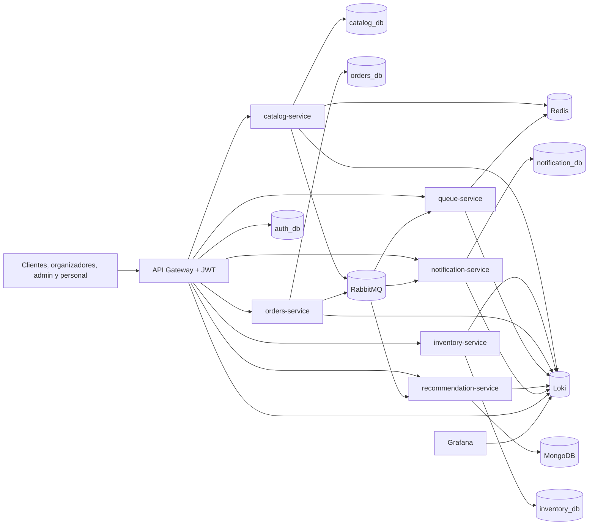
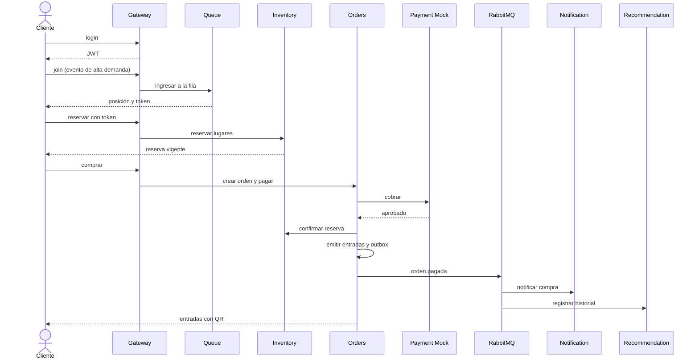

# Plan de trabajo — Entrega 2 (13 al 22 de noviembre de 2026)

Plan día por día para completar el sistema TicketYa. El alcance funcional está en
[`openspec/changes/entrega-2-completo/`](../openspec/changes/entrega-2-completo/) y la
trazabilidad en [`checklist-entrega-2.md`](checklist-entrega-2.md).

## 1. Resumen

- **Entrega 2:** sistema completo (ítems 6, 8, 10, 11 y 12 del enunciado) más JWT, MongoDB,
  saga/compensaciones, resiliencia, cache, log centralizado, Docker, pruebas de integración y
  prueba de carga.
- **Fecha límite:** domingo 22 de noviembre de 2026.
- **Días de trabajo:** 10, contando el viernes 13.
- **Equipo:** 5 personas. P1 Iván, P2 Pablo, P3 Caro, P4 Tiago, P5 Franco.
- **Repositorio:** `Pabloaguirre23/ArquitecturaWeb`, carpeta `TP-TicketYa/`, rama `main`
  protegida. El checkout local `ticketya/` es el subtree que se publica en `TP-TicketYa/`;
  la sincronización con el repo del curso se verifica en la tarea 1.1 y se cierra en la 10.8.
  El repositorio `Francogp131/TicketYa` queda como espejo de trabajo si hace falta.
- **Estrategia:** congelar el contrato v2 el Día 1, construir en paralelo por servicio,
  integrar todos los días y congelar funcionalidad el viernes 20 a las 18:00. Los últimos dos
  días son para verificación, carga, documentación y cierre.
- **Regla de oro:** ninguna tarea se marca terminada sin la verificación indicada en
  `tasks.md` y sin evidencia en el PR.

## 2. Alcance y responsables

| Ítem del enunciado / requisito | Capacidad OpenSpec | Servicio(s) | Dueño | Tareas |
|---|---|---|---|---|
| 6. Fila virtual | `fila-virtual` | queue + inventory + catalog | P2 | 4.1–4.4, 5.1, 5.4 |
| 8. Control de acceso con QR | `control-acceso-qr` | orders | P3 | 6.4 |
| 10. Preferencias y recomendaciones | `preferencias-recomendaciones` | recommendation (MongoDB) | P5 | 7.1–7.5 |
| 11. Notificaciones | `notificaciones` | notification + RabbitMQ | P1 | 8.1–8.4 |
| 12. Reportes | `reportes-organizador` | orders + catalog | P3 | 6.5 |
| JWT y roles | `seguridad-jwt` | gateway + todos | P4 | 2.1–2.8 |
| Consistencia y compensaciones | `consistencia-saga` | orders + catalog + consumidores | P3/P1/P5 | 6.2, 6.3, 3.2 |
| Resiliencia | `resiliencia-servicios` | todos los clientes | P2/P3/P4 | 5.3, 6.6, 2.3 |
| Cache | `cache-catalogo` | catalog + Redis | P1 | 3.3, 3.4 |
| Bitácora y log centralizado | `observabilidad` | todos | P4/P1/P3 | 9.1–9.4 |
| Docker y compose | `despliegue-contenedores` | todos | P4 | 9.5–9.7 |
| Integración, seguridad y carga | — | todos | P5/P4/P2 | 10.1–10.4 |

### 2.1 Arquitectura objetivo



### 2.2 Flujo de compra objetivo



## 3. Equipo y carga

| Persona | Nombre | Foco | Tareas | Cantidad |
|---|---|---|---|---|
| P1 | Iván | `catalog-service` + `notification-service` | 1.8, 2.4, 3.1–3.7, 8.1–8.4, 9.2 | 14 |
| P2 | Pablo | `inventory-service` + `queue-service` | 1.6, 2.5, 4.1–4.4, 5.1–5.5, 10.3 | 12 |
| P3 | Caro | `orders-service` | 2.6, 6.1–6.7, 9.3, 10.2, 10.5 | 11 |
| P4 | Tiago | `api-gateway` + infraestructura | 1.3–1.5, 2.1–2.3, 2.8, 9.1, 9.4–9.7, 10.8 | 13 |
| P5 | Franco | `recommendation-service` + calidad e integración | 1.1, 1.2, 1.7, 2.7, 7.1–7.5, 10.1, 10.4, 10.6, 10.7, 10.9 | 14 |

La carga está balanceada a propósito: P4 y P5 llevan la delantera en infraestructura e
integración, y P1/P2/P3 tienen un servicio principal cada uno. Todos revisan PR de todos.

**Primer commit de cada uno (Día 1):**

| Persona | Rama | Tarea | Primer entregable |
|---|---|---|---|
| P1 | `feat/notification-esqueleto` | 1.8 | Servicio de notificaciones con health |
| P2 | `feat/queue-esqueleto` | 1.6 | Servicio de fila con Redis y health |
| P3 | `feat/orders-migracion-v5` | 6.1 | Migración V5 revisada |
| P4 | `docs/contrato-v2` | 1.3 | Contrato v2 con roles y ejemplos |
| P5 | `docs/equipo-entrega-2` | 1.1, 1.2 | Repo verificado y criterios US-25 a US-38 |

> **Regla de commits:** cada tarea se entrega en una rama `feat/<servicio>-<tema>` (o
> `docs/<tema>`) y un PR pequeño contra `main`. Un PR no se aprueba sin tests, OpenAPI,
> contrato y README actualizados. No se mergea sin al menos una aprobación.

## 4. Ruta crítica

```
Contrato v2 + JWT (1.3, 2.1–2.3)
   → Infra Redis/Mongo/Rabbit (1.4)
   → Fila virtual y token (4.1–4.3, 5.1)
   → Saga + outbox de compra (6.2, 6.3, 3.2)
   → Acceso QR y reportes (6.4, 6.5)
   → Notificaciones y recomendaciones (8.1–8.4, 7.1–7.5)
   → Compose integral + integración + seguridad (9.5–9.7, 10.1, 2.8)
   → Carga y cierre (10.3, 10.4, 10.8)
```

Si se atrasa un eslabón, se termina la ruta crítica antes que cualquier extra. La fila virtual
y las recomendaciones pueden simplificarse (polling, reglas explicables) pero no pueden faltar.

## 5. Cronograma día por día

### Día 1 — Viernes 13/11: fundaciones, contrato e infraestructura

**Objetivo:** que los cinco puedan trabajar en paralelo el sábado sin bloquearse.

| Persona | Tareas | Entregable |
|---|---|---|
| Todos | Leer `proposal.md`, `specs/` y `design.md`; revisar el contrato v2 | Alcance y matriz de roles entendidos |
| P4 | 1.3 contrato v2, 1.4 Redis/Mongo/Rabbit, 1.5 sobre de eventos | Contrato congelado e infraestructura healthy |
| P5 | 1.1 acceso al repo del curso, 1.2 criterios US-25 a US-38, 1.7 esqueleto de recommendation | Repo verificado y briefs listos |
| P2 | 1.6 esqueleto de queue-service | `queue-service` compila y responde health |
| P1 | 1.8 esqueleto de notification-service | `notification-service` compila y responde health |
| P3 | 6.1 migración V5 de orders (borrador) | Migración revisada con el diseño |

**Verificación del día:** `docker compose -f docker-compose.dev.yml config`; health de Redis,
MongoDB y RabbitMQ; build de los tres servicios nuevos; contrato con todos los endpoints y
roles; `openspec validate entrega-2-completo --strict` verde.

**Riesgo:** que el contrato quede incompleto y se descubra el miércoles. Mitigación: revisión
cruzada de P1/P2/P3/P5 antes de cerrar el día.

---

### Día 2 — Sábado 14/11: JWT, alta demanda y modelos base

| Persona | Tareas | Entregable |
|---|---|---|
| P4 | 2.1 login + usuarios, 2.2 filtro JWT | Login y rutas protegidas con 401/403 |
| P1 | 3.1 alta demanda, límite y edición de evento; 3.2 outbox | Migración y eventos de catálogo |
| P2 | 4.1 modelo Redis de la fila, 4.2 scheduler de tandas | Ingreso y posición funcionando |
| P3 | 6.1 migración V5, 6.2 saga de compra | Saga con estados persistidos |
| P5 | 7.1 MongoDB e índices, 7.2 preferencias | Preferencias persistidas |

**Verificación del día:** login 200/401; endpoint protegido 401 sin token y 200 con rol; fila
con posición y reingreso idempotente; migraciones aplican sobre una base de Entrega 1; tests
unitarios de cada tarea.

**Riesgo:** el cambio de identidad rompe Postman. Mitigación: P4 y P3 actualizan la colección
en el mismo PR y dejan una carpeta de compatibilidad solo para tests internos.

---

### Día 3 — Domingo 15/11: fila, token de compra, acceso y saga

| Persona | Tareas | Entregable |
|---|---|---|
| P4 | 2.3 token interno, 2.8 matriz de seguridad (inicio) | Endpoints internos protegidos |
| P1 | 3.3 cache de catálogo, 8.1 tabla y sender de notificaciones | Cache y base de notificaciones |
| P2 | 4.3 cierre/reinicio de fila, 5.1 token de fila en inventory | Reserva con token validado |
| P3 | 6.2 cierre de saga, 6.4 acceso QR | QR validado con concurrencia |
| P5 | 7.3 historial de compras, 7.4 recomendaciones (inicio) | Historial idempotente |

**Verificación del día:** reserva de evento de alta demanda sin token → 403 y con token → 201;
dos escaneos concurrentes → un 200 y un 409; cache hit/miss; evento duplicado no duplica
historial.

**Riesgo:** la validación del token de fila agrega una dependencia. Mitigación: firma HMAC
compartida y validación local en inventory, sin llamada a queue-service en el camino crítico.

---

### Día 4 — Lunes 16/11: notificaciones, reportes y endpoints internos

| Persona | Tareas | Entregable |
|---|---|---|
| P4 | 9.1 logging JSON, 9.4 Loki/Promtail/Grafana (inicio) | Correlación en logs |
| P1 | 3.4 invalidación de cache, 3.5 datos internos, 8.2 consumidor de compra | Notificación de compra asíncrona |
| P2 | 5.2 cancelación de reserva, 5.3 resiliencia de inventory | Reserva cancelable y tolerante a fallos |
| P3 | 6.3 outbox de orders, 6.5 reportes | Reporte por evento y eventos de compra |
| P5 | 7.4 recomendaciones y co-compra, 7.5 similares | Recomendaciones con fallback |

**Verificación del día:** compra pagada → notificación `ENVIADA`; cancelación de reserva
idempotente; reporte con ventas/devoluciones/ocupación; recomendaciones con y sin historial;
fallo de RabbitMQ no pierde el outbox.

**Riesgo:** el reporte depende de catalog. Mitigación: cache de capacidad/precio y fallback
marcado como desactualizado.

---

### Día 5 — Martes 17/11: cierre de servicios, Dockerfiles y documentación de servicio

| Persona | Tareas | Entregable |
|---|---|---|
| P4 | 9.4 cierre de observabilidad, 9.5 Dockerfiles | Siete imágenes construibles |
| P1 | 3.6 integración con queue, 8.3 cancelación/cambio/favorito, 3.7 docs de catalog | Notificaciones completas |
| P2 | 4.4 docs de queue, 5.4 reconciliación, 5.5 docs de inventory | Servicios documentados |
| P3 | 6.6 resiliencia de pagos/inventory, 6.7 docs de orders | Compra tolerante a fallos |
| P5 | 2.7 seguridad de recommendation, 10.1 tests de integración (inicio) | Primer flujo E2E automatizado |

**Verificación del día:** `docker build` de los siete servicios; notificación de cancelación y
de artista favorito; circuit breaker abre y se recupera; OpenAPI de cada servicio actualizado.

**Riesgo:** los Dockerfiles consumen tiempo. Mitigación: plantilla común y revisión de P4 con
cada dueño; el compose integral se termina el Día 6.

---

### Día 6 — Miércoles 18/11: integración, compose y primera corrida E2E

| Persona | Tareas | Entregable |
|---|---|---|
| P4 | 9.6 compose integral, 9.7 CI | `docker compose up --build` y CI verde |
| P1 | 8.4 API de notificaciones, 9.2 auditoría de catalog | Notificaciones consultables |
| P2 | 2.5 seguridad de inventory/queue, 10.3 JMeter (inicio) | Matriz de roles y plan de carga |
| P3 | 9.3 auditoría de orders, 10.2 Postman v2 (inicio), 10.5 arquitectura | Bitácora, Postman y diagramas |
| P5 | 10.1 integración (cierre), 10.6 modelo de datos/ADR | Suite de integración verde |

**Verificación del día:** siete servicios healthy en compose; flujo login → buscar → fila →
reservar → comprar → QR → reporte por el gateway; una correlación presente en todos los logs;
CI con los siete builds.

**Riesgo:** el compose integral falla por recursos. Mitigación: perfil de observabilidad
opcional y límites de memoria documentados; probar primero en la máquina de P4.

---

### Día 7 — Jueves 19/11: estabilización, Postman y carga

| Persona | Tareas | Entregable |
|---|---|---|
| P1 | 3.7 docs de catalog, 8.4 fixes | Documentación de catálogo |
| P2 | 10.3 JMeter (cierre), 5.5 docs | Plan de carga reproducible |
| P3 | 10.2 Postman v2 (cierre), 6.7 docs, 10.5 arquitectura (cierre) | Newman verde y documentación de orders |
| P4 | 9.7 CI, 10.8 clone limpio (ensayo) | Build reproducible |
| P5 | 10.4 informe de carga, 10.6 docs, 10.1 fixes | Informe y documentación |

**Verificación del día:** Newman 100 %; primera corrida de 500 usuarios; suite completa de los
siete servicios; documentación de arquitectura y modelo actualizada; no hay features nuevas
después de este día.

**Riesgo:** la carga muestra un cuello de botella. Mitigación: priorizar índice/consulta y
pool de conexiones; documentar el resultado aunque no se optimice.

---

### Día 8 — Viernes 20/11: prueba de carga, fixes y congelamiento

| Persona | Tareas | Entregable |
|---|---|---|
| P2 | 10.3 corrida de 1000 usuarios y resultados crudos | Evidencia de carga |
| P5 | 10.4 informe final, 10.7 checklist | Informe y checklist al 100 % |
| P4 | 10.8 ensayo de clone limpio | RC reproducible |
| P1/P3 | Fixes de integración y seguridad | Suite verde |
| Todos | Revisión cruzada de PRs | PRs mergeados |

**Verificación del día:** corridas de 500 y 1000 usuarios con p50/p95/p99 y errores; suite
completa verde; checklist sin pendientes; **congelamiento de funcionalidad a las 18:00**.

**Riesgo:** aparece un bug grande a último momento. Mitigación: desde las 18:00 solo se aceptan
fixes; cualquier feature nueva se rechaza o se documenta como deuda.

---

### Día 9 — Sábado 21/11: release candidate y evidencia

| Persona | Tareas | Entregable |
|---|---|---|
| P5 | 10.7 evidencia final, 10.9 validación OpenSpec | Checklist y specs validados |
| P4 | 10.8 clone limpio + tag `entrega-2-rc` | RC verificado |
| P3 | Revisión de diagramas y reporte | Docs coherentes |
| P1/P2 | Revisión de OpenAPI/Postman y fixes menores | Contratos completos |
| Todos | Demo de 5 minutos ensayada | Guion de demo |

**Verificación del día:** clone limpio del RC, compose healthy, E2E y Newman verdes, matriz de
seguridad completa, `openspec validate --strict`, tag `entrega-2-rc`.

**Riesgo:** el entorno de la máquina de entrega difiere. Mitigación: probar en una máquina que
no haya desarrollado el código y dejar el `README` con los pasos exactos.

---

### Día 10 — Domingo 22/11: entrega

| Persona | Tareas | Entregable |
|---|---|---|
| P4 | 10.8 tag final `entrega-2` | Tag sobre el commit entregado |
| P5 | 10.9 cierre, enlace y resumen | Entrega subida |
| Todos | Verificación final del enlace y accesos | Repositorio accesible |

**Verificación del día:** tag `entrega-2` creado; repositorio del curso accesible; README,
checklist, OpenAPI, Postman e informe de carga enlazados; **no se toca código salvo un blocker
de último minuto**.

## 6. Rutina diaria y definición de terminado

**Cada día:**

1. Sync de 15 minutos: qué se hizo, qué sigue, qué bloquea.
2. Trabajo por tarea de `tasks.md`, en una rama `feat/<servicio>-<tema>`.
3. PR a `main` con al menos una aprobación; merge el mismo día.
4. Marcar el checkbox de `tasks.md` y dejar la evidencia en el PR.
5. Actualizar `docs/README.md` y el checklist si cambió el estado.
6. `openspec status --change entrega-2-completo`.

**Una tarea está terminada cuando:**

- El código compila y los tests de la tarea pasan.
- La verificación indicada en `tasks.md` se ejecutó y quedó registrada.
- El endpoint aparece en el OpenAPI y en `docs/api-contract.md` (si aplica).
- El README del servicio está actualizado.
- Otro integrante revisó el PR.
- No quedan TODOs, secretos ni datos hardcodeados fuera del seed.
- CI verde.

## 7. Prioridades y plan de contingencia

**P0 — no se negocia:**

- JWT con roles y matriz de seguridad.
- Fila virtual y token de compra.
- Control de acceso con QR y uso único.
- Notificaciones de compra y cancelación.
- Reportes por evento.
- Saga/compensaciones y no doble venta.
- Docker por servicio y compose integral.
- Pruebas de integración, seguridad y carga con evidencia.
- Entregables: README, OpenAPI, Postman, checklist y tag.

**P1 — se recorta si hay atraso:**

- Recomendaciones colaborativas avanzadas (basta preferencias + populares + co-compra simple).
- Cache de búsqueda con invalidación fina (basta TTL + invalidación por evento).
- Grafana con dashboards elaborados (basta Loki/Promtail y consulta por correlación).
- Reportes con filtros adicionales.

**P2 — se descarta sin culpa:**

- Interfaz gráfica.
- WebSockets para la fila.
- Machine learning para recomendaciones.
- Métricas avanzadas y alertas.

Si un día termina atrasado, al sync del día siguiente se reasigna a P4 o P5; se recorta P1
antes que P0. Si el atraso es de más de un día, se elimina el buffer del Día 9 y se trabaja
solo en la ruta crítica.

## 8. Riesgos principales

| Riesgo | Impacto | Mitigación |
|---|---|---|
| El cambio a JWT rompe los flujos existentes | Retrabajo en todos los servicios | Implementarlo primero en el gateway y actualizar Postman/tests el mismo día |
| Redis pierde la fila | Clientes sin posición | AOF, healthcheck y cierre controlado documentado |
| Outbox mal implementado | Eventos perdidos o duplicados | `FOR UPDATE SKIP LOCKED`, `eventId` único y consumidores idempotentes |
| La prueba de carga falla por la máquina | Informe incompleto | Documentar hardware, correr con perfil sin observabilidad y reportar percentiles |
| Docker consume demasiada memoria | El compose no levanta | Límites, perfiles y documentar requisitos mínimos |
| Mongo sin transacciones multi-documento | Historial inconsistente | Upserts idempotentes y una sola escritura por evento |
| Falta de tiempo para documentar | Entrega incompleta | Documentación en el mismo PR y Día 8 sin features |
| Miembros bloqueados entre sí | Paralización | Contrato congelado el Día 1, mocks/WireMock y PRs pequeños |

## 9. Entregable final

El domingo 22 se entrega el repositorio del curso con:

- Código fuente de los siete servicios y el gateway.
- `openspec/changes/entrega-2-completo/` con propuesta, specs, diseño y tareas.
- `docs/features-y-user-stories.md` con US-01 a US-38 y criterios completos.
- `docs/api-contract.md`, `docs/arquitectura.md`, `docs/modelo-datos.md`, `docs/decisiones.md`,
  `docs/seguridad.md`, `docs/pruebas.md`, `docs/informe-carga.md` y `docs/checklist-entrega-2.md`.
- OpenAPI/Swagger por servicio con `bearerAuth`.
- `docker-compose.yml` integral y un Dockerfile por servicio.
- Colección Postman/Newman actualizada.
- Tests unitarios, de integración, de seguridad y de no doble venta.
- Tag `entrega-2`.

La lista verificable está en [`checklist-entrega-2.md`](checklist-entrega-2.md).

## Anexo A — Interfaz gráfica opcional

La interfaz gráfica **no está en el alcance comprometido** de la Entrega 2. Se intenta solo si
los P0 están verdes al Día 8 y no pone en riesgo la entrega. Si no llega, no se entrega y se
documenta como trabajo futuro.

**Alcance mínimo propuesto:**

| Pantalla | Flujo | Datos que consume |
|---|---|---|
| Login | Email y contraseña | `POST /api/auth/login` |
| Búsqueda | Filtros por tipo, ciudad y fecha | `GET /api/catalog/events` |
| Detalle | Sectores, precios, disponibilidad y asientos | `GET /api/catalog/events/{id}`, inventory |
| Checkout | Reserva, pago mock y confirmación | inventory + orders |
| Mis entradas | Listado con QR | `GET /api/orders/tickets` |
| Reporte (opcional) | Métricas del evento para organizador | `GET /api/orders/reports/events/{id}` |

**Stack y despliegue:** React + Vite + TypeScript en `web/`, consumiendo el gateway en
`http://localhost:8080`; build estático servido por Nginx en un contenedor `web` del compose.
El JWT se guarda en memoria o `sessionStorage`; no se usan cookies.

**Puertas para arrancar:**

1. JWT, catálogo, reserva y compra funcionando por el gateway.
2. P0 de la Entrega 2 sin pendientes críticos.
3. Tiempo estimado: 2 días de P5 con apoyo de P4 para el contenedor y CORS.
4. Si el Día 8 a las 18:00 no está navegable, no se incluye en la entrega.

**OpenSpec:** si se aprueba, se crea un change separado `interfaz-cliente-web` con sus propios
specs y tareas; no se mezcla con `entrega-2-completo` para no comprometer el alcance.
